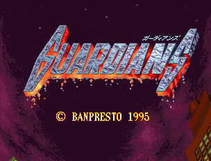
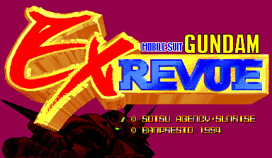
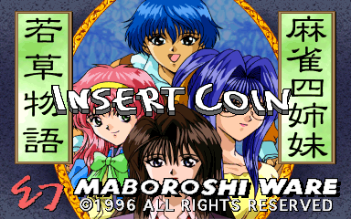
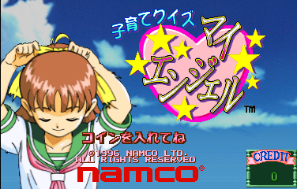
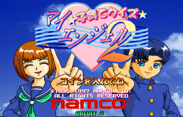
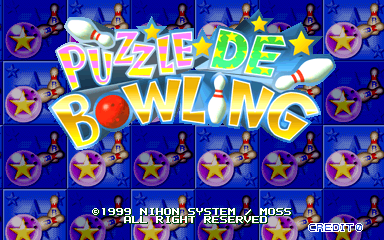

# Seta "newer hardware" (seta2) for MiSTer

The TMP68301 + X1-020 / DX-101 + X1-010 boards of MAME's `seta/seta2.cpp` driver, for the MiSTer FPGA platform:

| Game | Set | MRA |
|---|---|---|
| Guardians / Denjin Makai II (P-FG01-1 PCB, 1995) | `grdians` | `mra/Guardians.mra` |
| Guardians / Denjin Makai II (P0-113A PCB) | `grdiansa` | `mra/_alternatives/_Guardians/Guardians (P0-113A PCB).mra` |
| Guardians / Denjin Makai II (bootleg) | `grdiansbl` | `mra/_alternatives/_Guardians/Guardians (bootleg).mra` |
| Mobile Suit Gundam EX Revue (1994) | `gundamex` | `mra/Mobile Suit Gundam EX Revue.mra` |
| Wakakusamonogatari Mahjong Yonshimai (1996) | `mj4simai` | `mra/Wakakusamonogatari Mahjong Yonshimai.mra` |
| Kosodate Quiz My Angel (1996) | `myangel` | `mra/Kosodate Quiz My Angel.mra` |
| Kosodate Quiz My Angel 2 (1997) | `myangel2` | `mra/Kosodate Quiz My Angel 2.mra` |
| Puzzle De Bowling (1999) | `pzlbowl` | `mra/Puzzle De Bowling.mra` |
| Penguin Brothers (2000) | `penbros` | `mra/Penguin Brothers.mra` |
| Hong Tian Lei (A-Blast) (2000) | `ablast` | `mra/_alternatives/_Penguin Brothers/Hong Tian Lei (A-Blast).mra` |

| Guardians | Mobile Suit Gundam EX Revue |
|---|---|
|  |  |
| **Wakakusamonogatari Mahjong Yonshimai** | **Kosodate Quiz My Angel** |
|  |  |
| **Kosodate Quiz My Angel 2** | **Puzzle De Bowling** |
|  |  |
| **Penguin Brothers** | |
|  | |

The title screens as MAME 0.289 draws them.

Written for MiSTer from MAME 0.289's driver and devices (`seta2.cpp`, `x1_020_dx_101.cpp`, `tmp68301.cpp`, `x1_010.cpp`,
`eepromser.cpp`). The 68000 is [fx68k](https://github.com/ijor/fx68k) (Jorge Cwik); the X1-010 is `x1_010.sv` from ppriest's
[Arcade-Seta_MiSTer](https://github.com/ppriest/Arcade-Seta_MiSTer) (MAME's sound chip transcribed). kandowontu's
[Arcade-GundamEX_MiSTer](https://github.com/kandowontu2/Arcade-GundamEX_MiSTer) and
[Arcade-Guardians_MiSTer](https://github.com/MiSTer-devel/Arcade-Guardians_MiSTer) were read as references (board maps, CRTC
values, the timer and raster-interrupt behaviour of Guardians). No ROMs or other copyrighted data are in this repository; you supply
your own MAME romsets.

## Status

**Released.** Run on a real MiSTer by the repository owner (a MiSTer Multisystem 2, with a RetroTINK 4K in DV1 mode and with a
15 kHz CRT): every game loads and plays, with the picture and the sound; the named buttons, CRT Adjust, Turbo CPU / CPU speed, the
RT4K's DV1 and fast loading work. The first tests found, and the builds since fix: a black screen (the fast load's header), a
shredded picture on DV1 (the dot clock was not a whole number of machine clocks: now one core file per board dot clock), Gundam EX's
black screen when its demo starts (the decoding of its second program ROM), a dark, unsteady picture on the CRT (the long sync
pulses the games program: OSD "Sync widths") and the RT4K's "MiSTer Gen." class for Guardians and Penguin Brothers (now 262 lines,
see Timing). Checked in simulation against MAME 0.289 (details and numbers in `docs/status.md`):

* The ROM path: every region of the ten sets byte-identical to what MAME loads (`tools/seta2_rom.py check`, the load table read from
  `seta2.cpp` itself); the MRAs assemble to the core's images with the md5 MiSTer computes (`tools/make_mra.py`).
* The video chip, against a reference renderer (`tools/seta2_ref.py`, MAME's `x1_020_dx_101.cpp` written out: 237 of 240 MAME
  frames identical) and in the RTL's frozen-state bench through the real SDRAM controller and an SDRAM chip model: 234 of 240 MAME
  frames of the ten sets pixel-identical; the other six use Guardians' raster interrupt, which MAME draws in pieces.
* The whole machine from reset (program from the DDR3 through the cache, graphics from the SDRAM): Guardians' attract pictures
  identical to MAME's (39 of 40 up to frame 400), Puzzle De Bowling, Gundam EX, My Angel and Penguin Brothers too, a few frames
  apart from MAME (their boards' refresh rates are not MAME's 60 Hz).
* The X1-010, sample by sample against MAME's algorithm (25 s of Guardians: every sample within 1 LSB).
* Quartus 17.0.2: all three builds fit (block RAM 71 %, logic 45 %) with timing met on every clock.

Gundam EX's EEPROM starts from the MRA's image at every load (settings are not saved to the SD card).

## Install

1. The three core files `releases/seta2_YYYYMMDD.rbf`, `seta2grd_YYYYMMDD.rbf` and `seta2pen_YYYYMMDD.rbf` to
   `/media/fat/_Arcade/cores/`, and the contents of `mra/` to `/media/fat/_Arcade/`. Keep the names and dates: MiSTer finds a
   game's core by its MRA's `<rbf>` name plus the date. (One core file per board dot clock, see Timing; the MRAs pick the right
   one: Guardians `seta2grd`, Penguin Brothers / A-Blast `seta2pen`, the others `seta2`.)
2. Your MAME 0.289 romsets in `/media/fat/games/mame/`: `grdians.zip`, `gundamex.zip`, `mj4simai.zip`, `myangel.zip`,
   `myangel2.zip`, `pzlbowl.zip`, `penbros.zip` (merged sets hold the clones; with split sets add `grdiansa.zip`, `grdiansbl.zip`,
   `ablast.zip`).
3. Start a game from the Arcade menu. With a recent Main_MiSTer the image (up to 41 MB) goes straight into the DDR3 (the MRAs'
   `address=`) and the core copies the graphics into the SDRAM in about a second; an older Main_MiSTer streams it, which takes longer.

Memory: the graphics ROM (up to 32 MB) is in the SDRAM, the program and the samples in the DDR3: a 32 MB SDRAM module is enough
for every set.

## Controls

8-way joystick, the game's buttons, Start and Coin; on the keyboard MAME's defaults: 1 / 2 start, 5 / 6 coin, 9 service (the
service coin). The buttons are named as the games call them (Gundam EX and Puzzle De Bowling in their How To Play screens; the
order checked by pressing each in MAME):

| Game | A | B | X | Y |
|---|---|---|---|---|
| Guardians | Attack | Jump | Special (the power gauge's attack) | |
| Gundam EX | Soft Attack | Medium Attack | Hard Attack | Throw |
| My Angel 1 / 2 | Answer 1 | Answer 2 | Answer 3 | Answer 4 |
| Puzzle De Bowling | Left Curve | Throw (straight ball) | Right Curve | |
| Penguin Brothers, A-Blast | Bomb | Jump | | |

My Angel 1 / 2 have no joystick. Mahjong Yonshimai uses the keyboard's mahjong keys (MAME's defaults:
A-N, Kan LCtrl, Pon LAlt, Chi Space, Reach LShift, Ron Z, Bet 2, Flip Flop Y, Last Chance RAlt, Take Score RCtrl, Double Up
RShift, Big Enter, Small Backspace). Test modes: the Service Mode DIP switch, then reset.

## OSD

* **Aspect ratio**, **Scale**, **Scandoubler Fx**: as the owner's other cores. Scale (Normal, V-Integer, HV-Integer, Narrower
  HV-Integer, HV-Integer+) is integer scaling on the HDMI scaler (the framework's video_freak): Normal is the plain picture; the
  others ask the scaler for a whole-number size, the largest whole multiple of the picture's height that fits the screen and a width
  of the aspect ratio's (V-Integer) or a whole multiple of the picture's width (Narrower: the multiple below the aspect ratio's
  width, HV-Integer+: the one above it while it fits, HV-Integer: the nearer). With Aspect ratio Full Screen the integer modes use
  the screen's own proportions. The 15 kHz analog output is not affected. The core's horizontal blank toggles on every line, the
  vertical blank's included, as the framework's scandoubler needs (Scandoubler Fx, MiSTer.ini's forced_scandoubler).
* **CRT Adjust** (a page of its own; rmonic79's MiSTer-CRT-Adjust): the size and place of the picture on a 15 kHz analog output
  without the monitor losing its lock. The picture goes through a line buffer and is read out at another rate or another place in
  the line, and the vertical sync is moved by whole lines; the sync pulses keep their rate. **CRT H-Size** -16..+15: a step is 1/64
  of the picture's width, and the picture grows or shrinks about its own centre. **CRT H-Position** -48..+48 dots. **CRT V-Shift**
  -16..+15 lines, positive moves the picture down. Off by default; it does nothing while the scandoubler is in use, and the HDMI
  picture follows it, so leave it Off for HDMI and direct video (DV1). The room the games leave (beyond it the picture's edge is
  cut, or its first / last lines fall into the vertical sync):

  | Game | H-Size about the centre | H-Position | V-Shift |
  |---|---|---|---|
  | Guardians | up to +6 | -59..+15 | -17..+10 |
  | Gundam EX | up to +7 | -73..+22 | -20..+14 |
  | Mahjong Yonshimai | up to +10 | -67..+31 | -12..+7 |
  | My Angel, My Angel 2 | up to +14 | -61..+43 | -12..+7 (My Angel 2: -11..+8) |
  | Puzzle De Bowling | up to +14 | -54..+44 | -13..+7 |
  | Penguin Brothers, A-Blast | up to +9 | -67..+23 | -12..+23 |

  The pictures sit right of the line's middle (the right margin is the smaller), so a larger H-Size fits with the picture moved left.
* **DIP switches**: each game's, as MAME 0.289 defines them, with MAME's defaults; Gundam EX's Language jumper too.
* **Volume**: Normal is MAME's mix (the X1-010's two outputs into one speaker), then 6 / 12 / 18 dB lower.
* **Pause**: stops the CPU and the sound chip; the picture stays.
* **Turbo CPU** (Guardians only) and **CPU speed** (Gundam EX only), as in the Guardians and Gundam EX MiSTer cores: the 68000
  alone runs faster, for less slowdown when the screen is busy; the sound chip, the TMP68301 timers (Guardians' music tempo) and
  the video keep the board's rates. Guardians: Off (16.67 MHz; 16.27 MHz on the P0-113A board and the bootleg) or On, 23.44 MHz.
  Gundam EX: Native 16.27 MHz, Turbo 20.33 MHz (+25 %), Turbo 22.36 MHz (+37 %). Off / Native is the board and the default. The
  other cores go to 25 and 30 MHz; here the most is a quarter of the core file's clock, because the 68000 (fx68k) is given two of
  those clocks for each of its steps and needs them (its longest path is 12.8 ns, a clock 10.7-11.2 ns).
* **Sync widths**: Standard (default) caps the horizontal sync at ~4.7 us and the vertical sync at 3 lines; Board gives them as the
  games program them (Guardians 7.5 us and 4 lines, Penguin Brothers / A-Blast 9.1 us), which some TVs show dark and unsteady.
* **SDRAM read capture**: a diagnostic for SDRAM modules that answer late.

## Timing

TMP68301 and X1-010 at 50 MHz / 3 = 16.667 MHz (Gundam EX, the P0-113A Guardians and the bootleg: 32.53047 MHz / 2), as MAME.
The picture uses the CRTC values the games program, with each board's dot clock: the 384-wide games 8.13 MHz, ~60.0 Hz (261-262
lines). Guardians and Penguin Brothers / A-Blast get 262 lines instead of their CRTC's 259 and 256, with a line two or four dots
shorter so that the frame rate stays near the boards' (Guardians) or MAME's (Penguin Brothers): Guardians 6.25 MHz, 409 x 262, 58.3
Hz (CRTC 411 x 259 = 58.7 Hz; measured on the boards: 58.27-58.5 Hz); Penguin Brothers 7 MHz, 445 x 262, 60.0 Hz (CRTC 449 x 256 =
60.9 Hz). The RetroTINK 4K sorts a MiSTer direct-video signal into a class by its lines per frame: with 259 or 256 lines it took
these games as "MiSTer Gen.", in which it squashes the picture while the MiSTer OSD is open, and with 262 as "MiSTer 240p", like the
other games. The picture and the syncs keep their positions; the added lines and the removed dots are blanking. MAME runs every set
at exactly 60 Hz.

Each core file runs its machine at a whole multiple of its boards' dot clock, so every dot is the same number of clocks (a
direct video output such as the RetroTINK 4K's DV1 mode samples on that grid): `seta2grd` 93.75 MHz (6.25 MHz x 15), `seta2`
89.4588 MHz (32.53047 MHz / 4 x 11), `seta2pen` 91 MHz (7 MHz x 13).

## Build

Quartus Prime Lite 17.0, three revisions of `Seta2.qpf`: `quartus_sh --flow compile Seta2 -c Seta2` (and `-c Seta2Grd`,
`-c Seta2Pen`); `py -3.8 tools/release.py` copies them to `releases/` with their names. The MRAs: `python tools/make_mra.py` (reads MAME 0.289's romsets and
`src/mame/seta/seta2.cpp`; `tools/paths.py` says where).

## Simulation (Verilator 5 in WSL)

The benches build in WSL's `$HOME/build_seta2`; MAME's captures, the ROM images and the benches' pictures go to a scratch folder
`work/` next to the repository (never committed; `WORK=` for another place). `tools/paths.py` says where MAME, the romsets and
MAME's source are (`tools/paths_local.json` or environment variables).

```
sim/video/run.sh <statedir> <frame>...                     # the video chip on frozen MAME states, vs MAME's pixels
sim/sys/run.sh <image> <frames> <out> +every=10 [+wav]     # the whole machine from reset (tools/seta2_image.py makes the image)
sim/snd/run.sh <x1.log> <x1snd.bin> <seconds> <out.wav>    # the X1-010 with MAME's register writes (tools/lua/x1log.lua)
sim/crt/run.sh [15 13 11]                                  # CRT Adjust (rtl/s2_crtadj.sv + the line buffer) on each build's rasters
```

## Release

`py -3.8 tools/release.py` copies the three finished builds into `releases/` with their fitter / timing / RAM-depth reports;
`py -3.8 tools/package.py` writes `dist/Seta2_MiSTer_<date>.zip` in the SD card's structure (`_Arcade/**/*.mra`,
`_Arcade/cores/*.rbf`; no ROMs) for the GitHub release, with `dist/RELEASE_NOTES_<date>.md`.

## Credits

fx68k (Jorge Cwik); x1_010.sv (ppriest); CRT Adjust (rmonic79 / Umberto Parisi, with Andrea Bogazzi; `modules/VENDOR.md`; the glue
after the owner's Metro core); kandowontu's Guardians and Gundam EX cores (references, and the model of the Turbo CPU / CPU speed
options); the owner's Oh My God!, Monster Maulers and Heavy Unit cores (the platform layer, fast loading, Scale); the MiSTer
framework (Sorgelig and contributors); `mra_build.py` (plasticbugs); MAME
(Luca Elia and David Haywood wrote the seta2 driver and the video chip, Olivier Galibert the TMP68301, Manbow-J rewrote the X1-010).

## Licence

GPL-3.0-or-later (fx68k GPL-3.0; CRT Adjust GPL-3.0-or-later).
